# Task #50 — Browser End-to-End User Acceptance Testing

## Project
COMP 3613 — NestLink Student Accommodation System

## Objective
Validate the main student, landlord, and administrator
workflows through the actual web browser.

Confirm that the implemented features meet the public
acceptance criteria and preserve role-based permissions.

## Test Environment

- Application: NestLink
- Browser: Record the browser used
- Environment: Local development
- URL: http://127.0.0.1:5000
- Test date: To be recorded
- Tester: Daniel
- Test data: Disposable demo data only

## Test Accounts

Use the demonstration accounts documented in README.md:

- Administrator: admin
- Student: student
- Provisional student: incoming
- Landlord: landlord
- Second landlord: landlord2

Do not record passwords or authentication tokens in screenshots.

## Acceptance Test Cases

### UAT-01 — Student Authentication
Steps:
1. Open the login page.
2. Sign in using the registered student account.
3. Navigate to the student dashboard.

Expected:
- Authentication succeeds.
- Student-specific navigation appears.
- Administrator functions are not shown.

Status: PASS
Evidence: screenshots/UAT-01.png

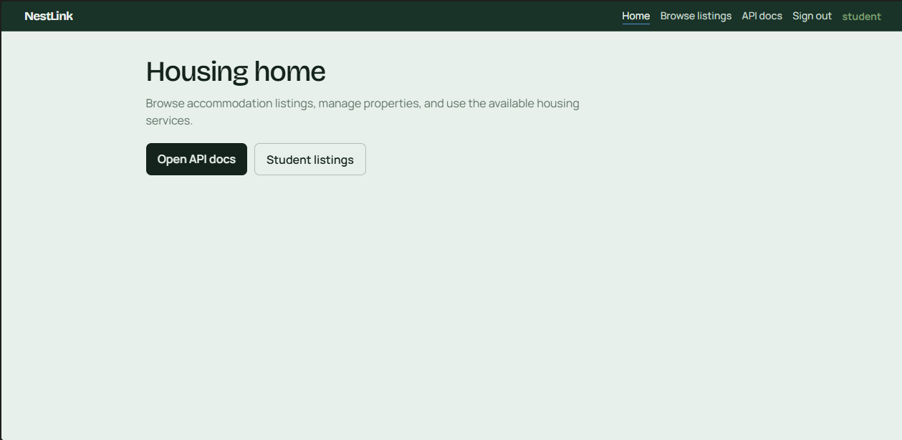

Notes: Student logged in successfully and student navigation appeared.

### UAT-02 — Student Browsing
Steps:
1. Sign in as an eligible student.
2. Open Browse Listings.
3. Observe the available properties.

Expected:
- Active, unrestricted listings appear.
- Pending and rejected listings are hidden.
- Location and landlord contact details are displayed.

Status: PASS
Evidence: screenshots/UAT-02.png

Notes: Available accommodation listings appeared with property and contact details. Pending listings were hidden.

### UAT-03 — Student Search Filters
Steps:
1. Open Browse Listings.
2. Apply an area filter.
3. Enter a maximum price.
4. Search for a matching amenity.

Expected:
- Only listings matching the filters appear.
- Invalid locations are rejected.
- Partial amenity names do not produce false matches.

Status: PASS
Evidence: screenshots/UAT-03-01.png, screenshots/UAT-03-02.png, screenshots/UAT-03-03.png

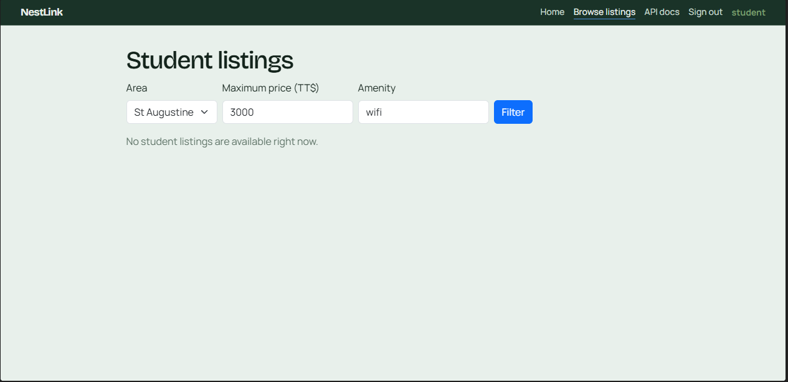

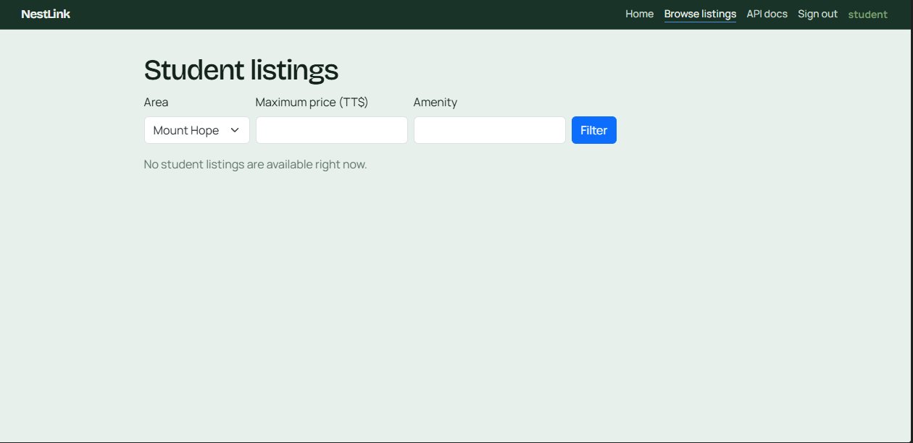

Notes: Location, maximum price, and amenity filters returned the expected results. Listings outside the selected criteria were excluded.

### UAT-04 — Listing Details
Steps:
1. Open an available listing.
2. Select View Details.
3. Inspect the property information.

Expected:
- Correct title, rent, location and amenities appear.
- Landlord contact information is visible.
- The student messaging form is available.

Status: PASS
Evidence: screenshots/UAT-04.png

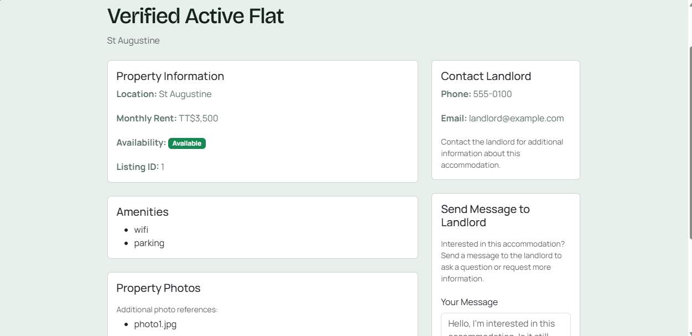

Notes: Active listing details displayed correctly, including location, rent, amenities, landlord contact information, and the messaging form.

### UAT-05 — Student Messaging
Steps:
1. Open an active listing.
2. Enter a valid message.
3. Submit the message.

Expected:
- The message is accepted.
- A success notification appears.
- The message is available in the owner's inbox.

Status: PASS
Evidence: screenshots/UAT-05.png

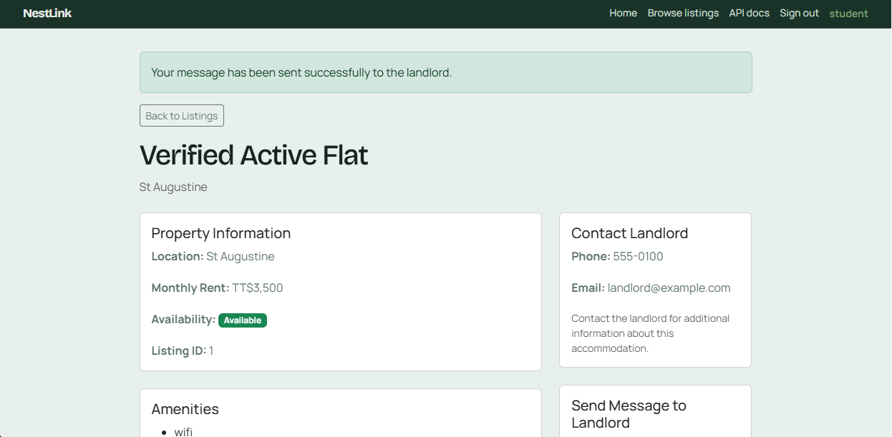

Notes: Student message submitted successfully. Inbox persistence to be cross-checked during UAT-12.

### UAT-06 — Landlord Listing Submission
Steps:
1. Sign in as a landlord.
2. Open Submit New Listing.
3. Complete the required information.
4. Submit the form.

Expected:
- The listing is created successfully.
- Its initial status is Pending.
- It is not publicly visible to students.

Status: PASS
Evidence: screenshots/UAT-06.png

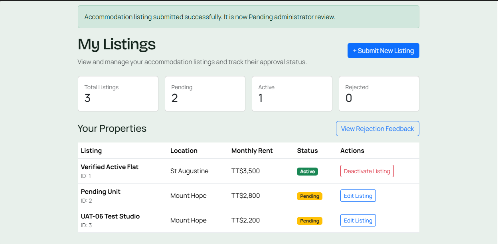

Notes: Landlord submitted UAT-06 Test Studio successfully. Listing was created with Pending status and could not be activated before administrator approval.

### UAT-07 — Landlord Listing Management
Steps:
1. Open My Listings.
2. View the newly submitted listing.
3. Edit the listing while it is Pending.
4. Save the changes.

Expected:
- Only the landlord's own listings appear.
- Permitted changes are saved.
- The listing retains its appropriate lifecycle status.

Status: PASS
Evidence: screenshots/UAT-07-01.png, screenshots/UAT-07-02.png

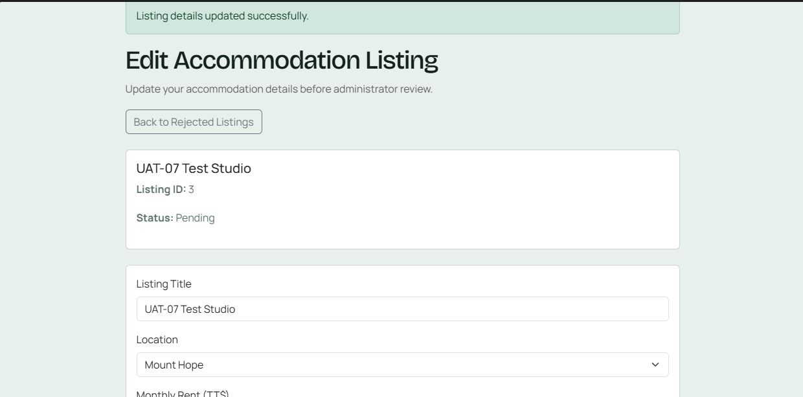

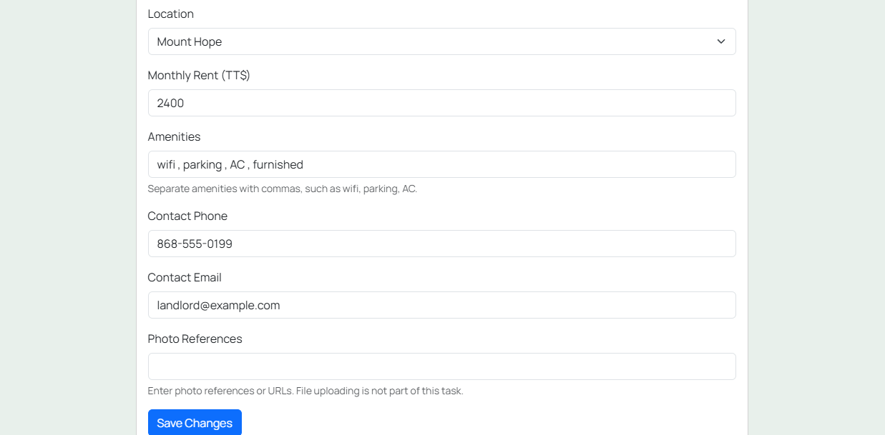

Notes: Landlord successfully edited the pending listing. Changes were saved and the listing remained Pending.

### UAT-08 — Administrator Verification
Steps:
1. Sign in as an administrator.
2. Open Manage Accommodation Listings.
3. Find a Pending listing.
4. Select Verify Listing.

Expected:
- The listing becomes Approved.
- The landlord can subsequently activate it.
- The listing does not become publicly visible
  until activation.

Status: PASS
Evidence: screenshots/UAT-08-01.png, screenshots/UAT-08-02.png

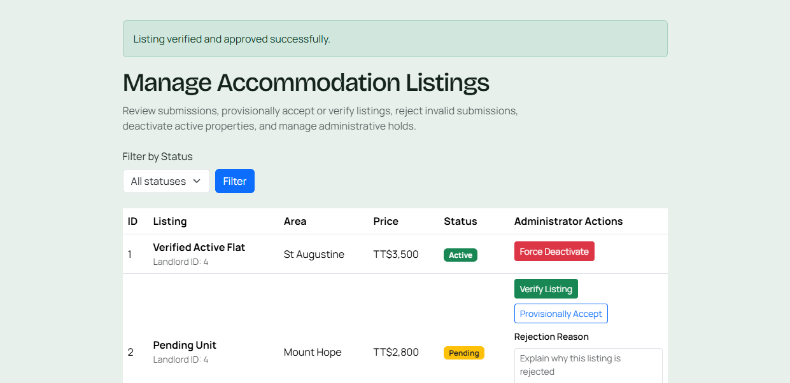

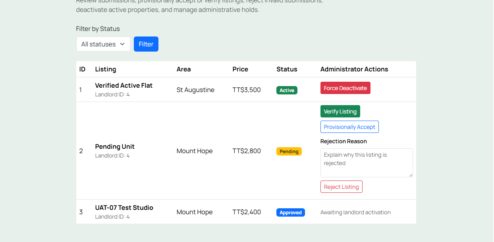

Notes: Administrator verified the pending accommodation listing. Its status changed to Approved, awaiting landlord activation.

### UAT-09 — Administrator Rejection
Steps:
1. Find another Pending listing.
2. Enter a rejection reason.
3. Select Reject Listing.
4. Check the landlord's rejection feedback page.

Expected:
- The listing becomes Rejected.
- The reason is saved and visible to its owner.
- The rejected listing is hidden from students.

Status: PASS
Evidence: screenshots/UAT-09-01.png, screenshots/UAT-09-02.png

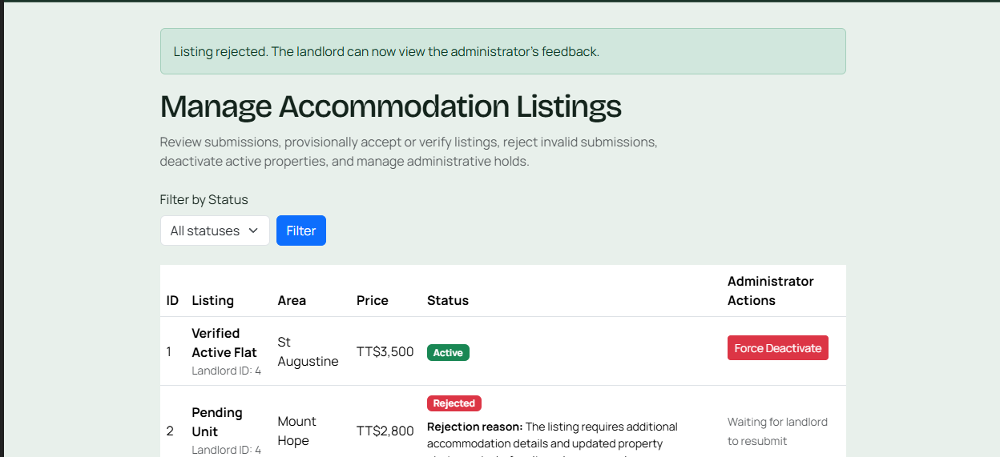

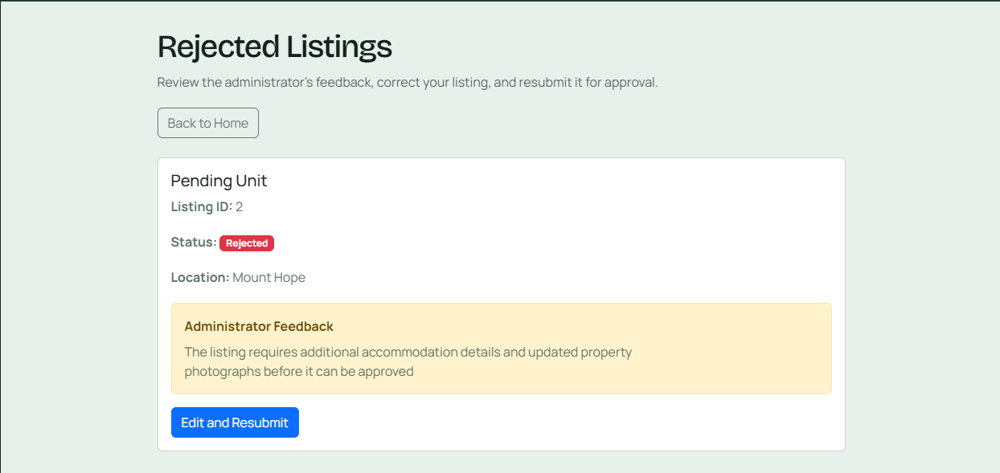

Notes: Administrator rejected a pending listing with feedback. The landlord could view the rejection reason, and the listing remained hidden from students.

### UAT-10 — Activation and Deactivation
Steps:
1. Sign in as the owner of an Approved listing.
2. Activate the listing.
3. Verify that students can see it.
4. Deactivate the listing.
5. Check student browsing again.

Expected:
- Approved becomes Active.
- Active listings are visible to eligible students.
- Deactivated listings become Inactive.
- Inactive listings disappear from student browsing.

Status: PASS
Evidence: screenshots/UAT-10-01.png, screenshots/UAT-10-02.png, screenshots/UAT-10-03.png

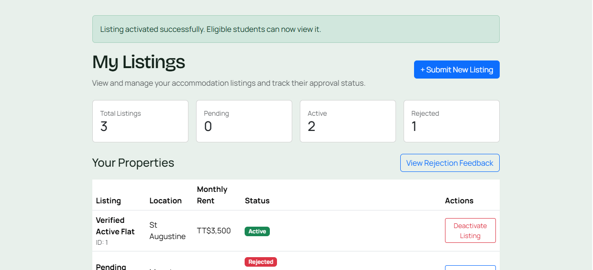

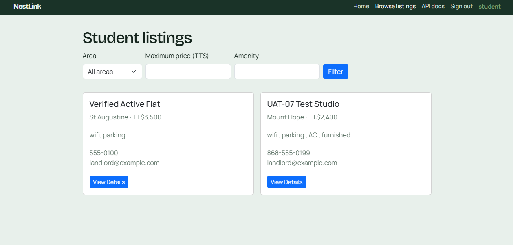

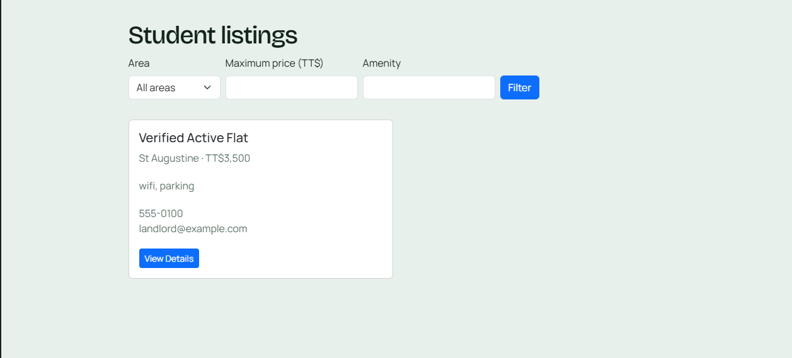

Notes: Landlord successfully activated and deactivated an approved listing. Student visibility followed the listing's lifecycle status.

### UAT-11 — Administrator Hold and Reverification
Steps:
1. Sign in as an administrator.
2. Force deactivate an Active listing.
3. Confirm that administrative hold is applied.
4. Release the administrative hold.
5. Complete reverification.
6. Sign in as the owner and reactivate.

Expected:
- Forced deactivation results in Inactive status.
- The landlord cannot activate while on hold.
- Hold release requires reverification.
- Reverification does not automatically activate.
- Reactivation succeeds after restrictions are cleared.

Status: PASS

Evidence: screenshots/UAT-11-01.png, screenshots/UAT-11-02.png, screenshots/UAT-11-03.png, screenshots/UAT-11-04.png, screenshots/UAT-11-05.png, screenshots/UAT-11-06.png, screenshots/UAT-11-07.png, screenshots/UAT-11-08.png

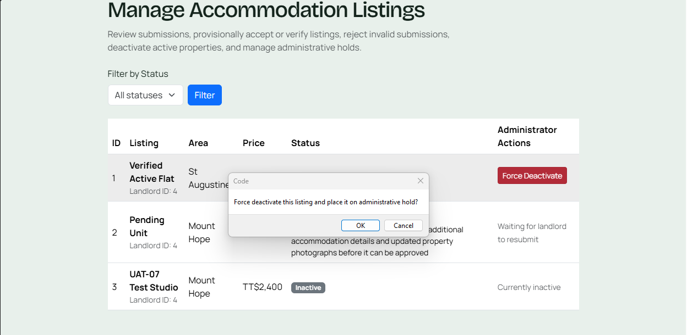

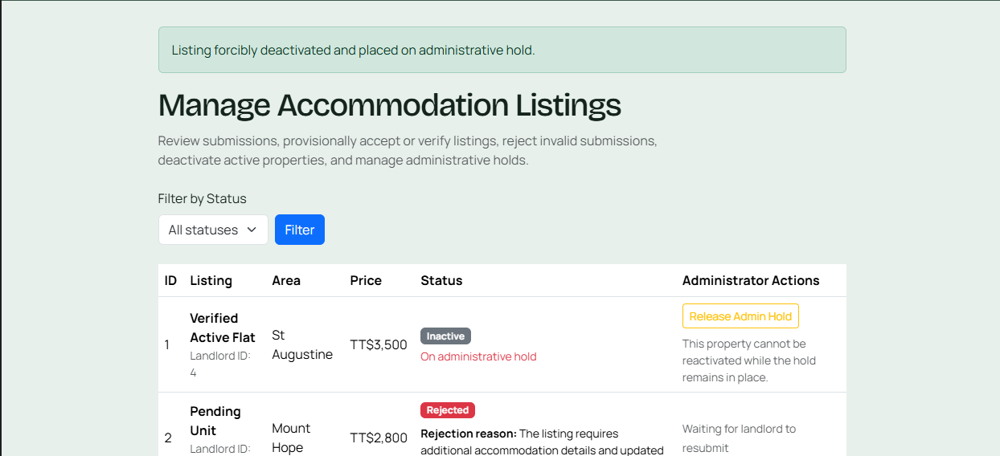

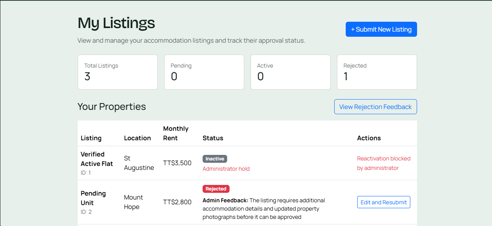

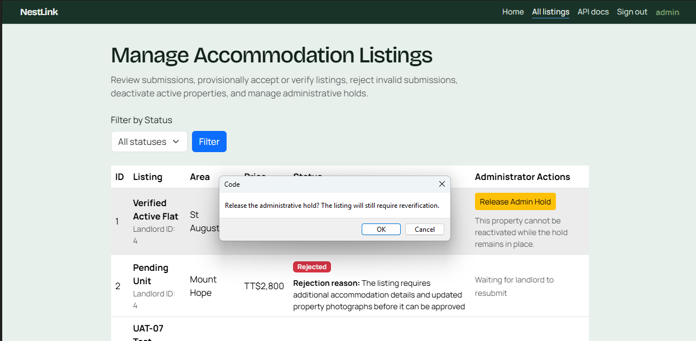

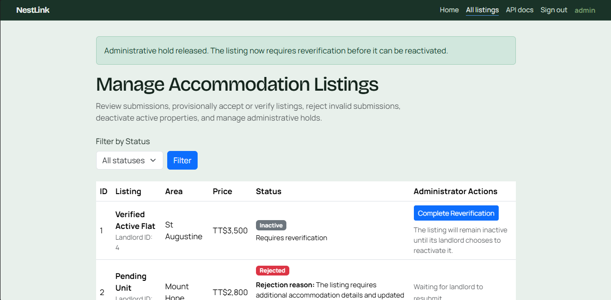

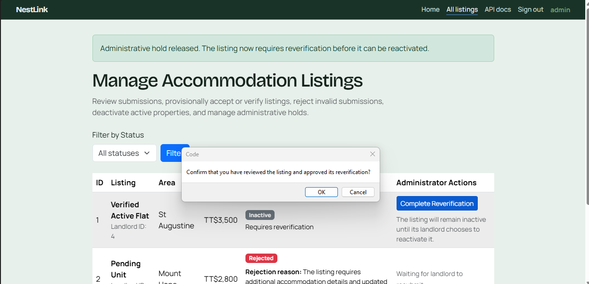

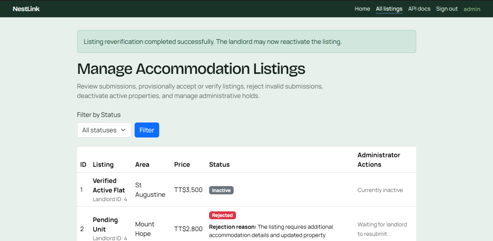

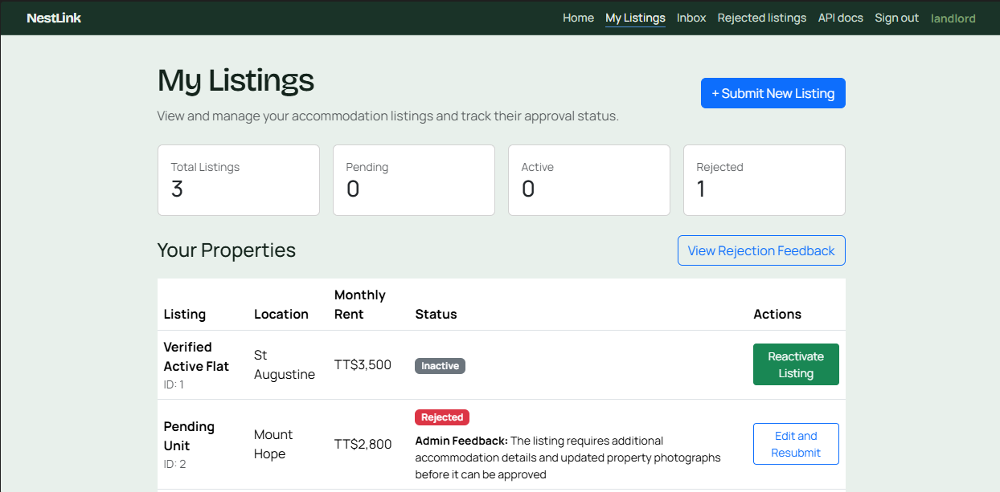

Notes: The administrator successfully force-deactivated an active listing and placed it on administrative hold. Landlord reactivation was blocked until the hold was released and reverification was completed. After administrator approval, the landlord successfully reactivated the listing.

### UAT-12 — Landlord Inbox
Steps:
1. Sign in as a landlord.
2. Open the message inbox.
3. Locate a message sent by a student.

Status: PASS

Evidence: screenshots/UAT-12.png

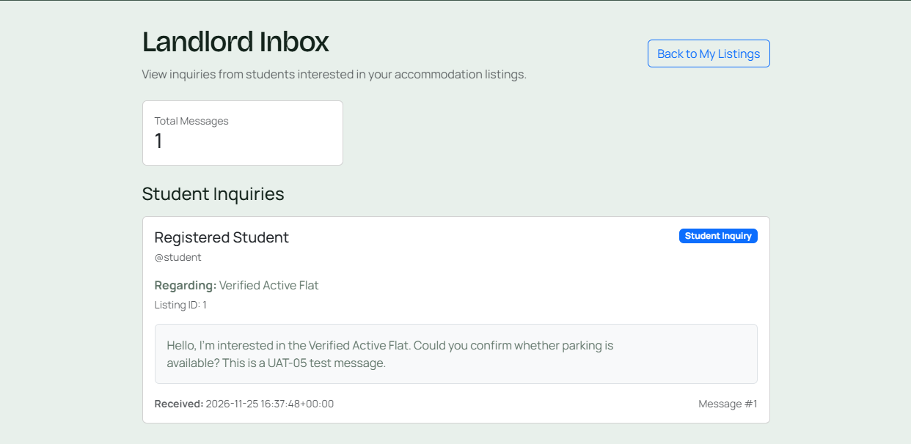

Notes: The landlord successfully received and viewed the student's message in the inbox. The correct sender, listing details, and message content were displayed. The second landlord could not access messages belonging to another landlord's listings.

Status: PASS
Evidence: screenshots/UAT-12.png, screenshots/UAT-12-other-landlord.png

Notes: The landlord successfully received and viewed the student's message in the inbox. The correct sender, listing details, and message content were displayed. The second landlord could not access messages belonging to another landlord's listings.

### UAT-13 — Role-Based Access Restrictions
Steps:
1. Sign in as a student.
2. Attempt to open an administrator page.
3. Sign in as a landlord.
4. Attempt to access restricted administrator functions.

Expected:
- Unauthorized requests are denied.
- Protected administrator actions remain unavailable.
- No restricted listing data is modified.

Status: PASS

Evidence: screenshots/UAT-13-01.png, screenshots/UAT-13-02.png

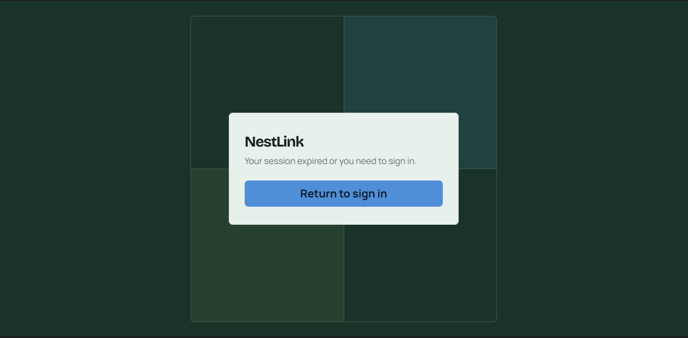

Notes: Student and landlord accounts were prevented from accessing the administrator listing management page. The application displayed its generic authorization error page rather than a dedicated access-denied page. Neither account could view the restricted administrator dashboard, confirming that role-based access restrictions were enforced.

### UAT-14 — Form Validation and Security
Steps:
1. Try submitting a form with missing required data.
2. Try entering an invalid price or location.
3. Verify that invalid requests do not create
   incorrect listing records.

Expected:
- Invalid submissions are rejected.
- Appropriate validation feedback is displayed.
- Existing valid data remains unchanged.

Status: PASS

Evidence: screenshots/UAT-14-01.png, screenshots/UAT-14-02.png, screenshots/UAT-14-03.png, screenshots/UAT-14-04.png

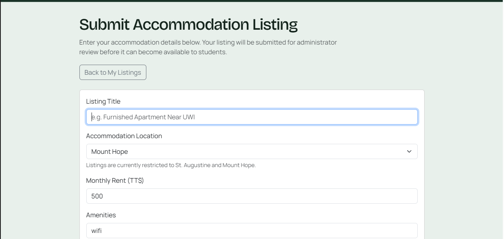

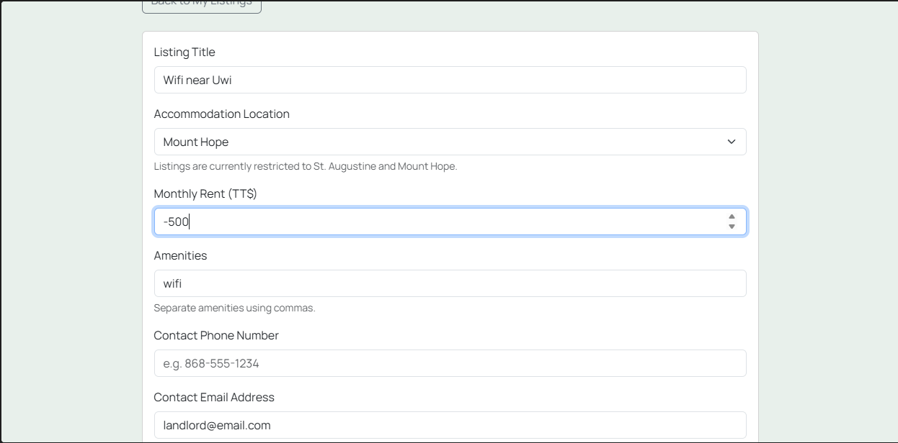

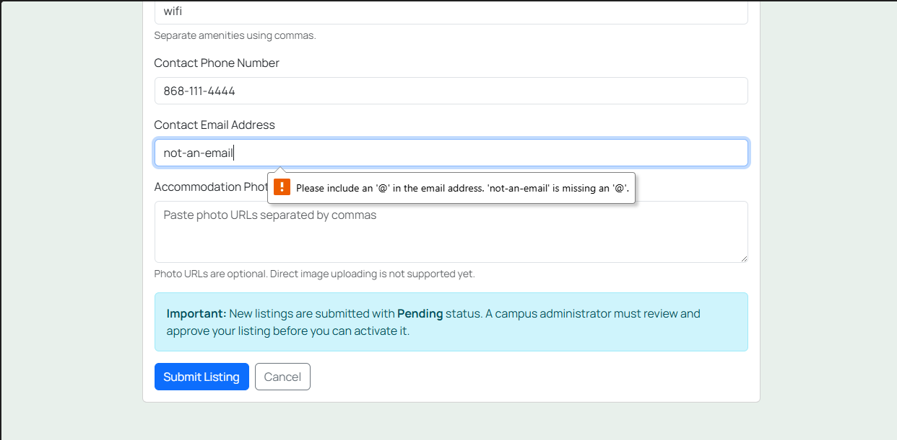

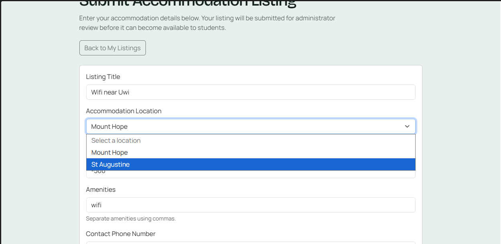

Notes: The system rejected submissions with missing required fields, invalid rental prices, and incorrectly formatted email addresses. Only approved accommodation locations were available for selection, and invalid submissions did not create new listing records.

## Defect Log

Record each discovered issue using:

- Defect ID:
- Related UAT case:
- Description:
- Expected behavior:
- Actual behavior:
- Severity:
- Screenshot:
- Resolution:
- Retest result:

## Final Test Summary

Total test cases: 14
Passed: 14
Failed: 0
Blocked: 0
Not run: 0

Overall result: PASS

## Conclusion

Browser-based user acceptance testing was conducted
for the NestLink Student Accommodation System.

Fourteen acceptance test scenarios were executed,
covering student authentication, accommodation browsing,
search filters, listing details, messaging, landlord
submission and management, administrator verification,
rejection, listing activation and deactivation,
administrative holds, reverification, role-based access
restrictions, and form validation.

All 14 scenarios passed, subject to the recorded
observations and supporting screenshot evidence.

The system demonstrated the expected functionality
across the student, landlord, and administrator
workflows.

No unresolved defects were identified during the
documented acceptance tests.

The application is considered ready for acceptance
based on the scenarios executed.

